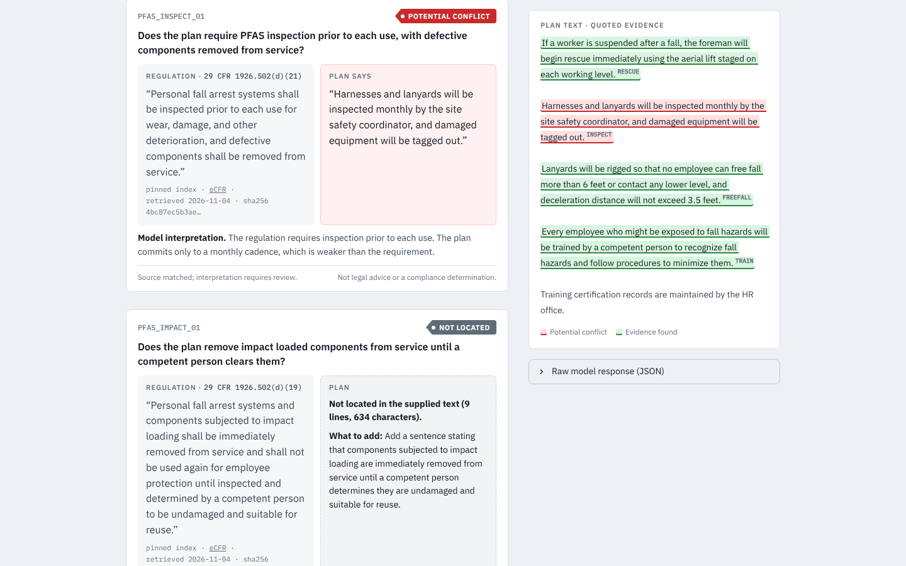

# ClauseGuard

**Precheck a personal fall arrest system (PFAS) plan before it goes to the general contractor.** A subcontractor's safety coordinator pastes or uploads a fall protection plan. ClauseGuard runs six review questions drawn from 29 CFR 1926.502 and 1926.503 and returns one of four statuses for each. Every status quotes the plan sentence it relied on and shows the governing regulation beside it. The coordinator fixes the plan, reruns, and watches the status change.

> Every result is labeled **source matched; interpretation requires review.** This is not legal advice, not a compliance determination, and not a substitute for a qualified safety professional. No accuracy figure is claimed, and no safety professional has reviewed the output.

Built for the **Meta Global AI Developer Hackathon** (Startup track, *Build for Your World*) on `muse-spark-1.3` through the Meta Model API.



| | |
|---|---|
| **Hosted demo** | https://claude.ai/artifact/12qtv92jfMzXbv48vBNJiM (stub mode; the owner must share it before others can open it) |
| **Demo video** | [`docs/demo.mp4`](docs/demo.mp4): 2 min 49 s recording of a real run in stub mode, with captions and a narrator voice synthesized locally by Kokoro (open weights TTS, Apache 2.0). Script: `docs/narration.json`; build: `scripts/narrate_demo.py` and `scripts/record_narrated.js` |
| **Full app** | `streamlit run app.py` (live model when `MODEL_API_KEY` is set) |

## Status of this build

| Area | Status |
|---|---|
| Streamlit app, validator, ingestion, UI | Working. Verified by 65 pytest tests, 23 JavaScript parity tests and 16 browser checks. |
| Hosted demo | Deployed as a static page. It uses the same index, stub data and a JavaScript validator held byte-for-byte to the Python one. |
| Live Meta Model API call | **Run.** 9 live calls to `muse-spark-1.3` (Plans A, B and an injection plan, three runs each): strict `json_schema` accepted every time, all 9 responses valid, every status stable across runs and as expected, and the injected instruction was not followed. See EVAL.md §7.2. Without a key, the app runs in **stub mode**; the hosted page and demo video use stub mode. |
| Regulatory text | Typed from knowledge of the regulation, because eCFR was blocked from the sandbox, then compared against the official OSHA copies of §1926.502 and §1926.503 on 2026-11-04: one comma in (d)(21) was corrected and the rest matched. Not yet read against eCFR by a human. |

The full disclosure is in [EVAL.md](EVAL.md).

## Why

Fall protection has been OSHA's most cited standard for fifteen consecutive fiscal years. Templated plan sections fail review in three different ways, and each needs a different response:

- **Explicit conflict.** The plan is weaker than the rule: inspection "monthly" instead of "prior to each use."
- **Not located.** The supplied text doesn't address the topic. That is a statement about the text, not proof the employer doesn't do it.
- **Needs information.** The plan points to a record that wasn't supplied, such as "records are kept by HR."

A tool that collapses all three into "missing requirement" produces confident, wrong conclusions. ClauseGuard keeps them apart and **never renders an incomplete review as a clean one.**

## How it works

```
1 Confirm scenario (conventional PFAS only) ── "No" ──▶ not supported, stop
2 Paste or upload (.txt, digital .pdf) ─▶ extraction preview: lines, characters, source, sha256
        └── under 40 characters ──▶ INCOMPLETE, Analyze disabled
3 ONE call to muse-spark-1.3 (strict json_schema, json_object fallback, temperature 0)
        returns per check: check_id, status, plan_span, interpretation, evidence_request
        never returns regulatory text
4 Local validation, deterministic, no model:
        exactly six results, the six expected IDs, no duplicates; status in the 4 values
        conflict/evidence: plan_span ≥ 20 chars AND found in the plan after normalization
        needs_info/not_located: evidence_request present; interpretation present; every field a string
5 Review: banner (REVIEW INCOMPLETE / not clean + open items / clean), per-status tally,
        stamp (plan sha256, index version, model ID, schema mode, UTC time), six cards
        (regulation from the pinned index | plan quote or follow-up request | interpretation),
        plan text with validated quotes highlighted, raw model JSON
6 Edit the plan ─▶ results clear on the first keystroke ─▶ rerun
```

**Division of labor.** The **model** reads plan prose and picks a status for each check. The **application** renders regulation text from a pinned, hashed index (the model never types regulation), confirms that every quoted sentence really occurs in the plan, and confirms that all six checks came back exactly once.

**Accounting is not correctness.** The validator proves the response is complete and that every quote is real. It does not prove the interpretation is right: a real sentence quoted for the wrong conclusion still passes. A test demonstrates this (`irrelevant_real_span_passes`).

**Interface.** The design is an inspection sheet: a steel-grey ground, white work surfaces and a hi-vis barrier stripe. Statuses are shaped like the equipment tags a competent person hangs on gear, using danger red, caution yellow and safety green (ANSI Z535 / OSHA 1910.145 colors). Citations are never uppercased, so `(b)(1)` stays `(b)(1)`. All plan text and model output is HTML-escaped before rendering.

### The six checks

| ID | Question | Source |
|---|---|---|
| `PFAS_RESCUE_01` | Prompt rescue, or self-rescue assured? | § 1926.502(d)(20) |
| `PFAS_INSPECT_01` | Inspected prior to each use; defective components removed? | § 1926.502(d)(21) |
| `PFAS_IMPACT_01` | Impact-loaded components removed until a competent person clears them? | § 1926.502(d)(19) |
| `PFAS_FREEFALL_01` | 6 ft free fall and 3.5 ft deceleration limits stated? | § 1926.502(d)(16)(iii)–(iv) |
| `PFAS_TRAIN_01` | Training program for employees exposed to fall hazards? | § 1926.503(a)(1) |
| `PFAS_CERT_01` | Written training certification record addressed? | § 1926.503(b)(1) |

These are excluded on purpose: guardrails, covers, nets, roofing alternatives, and the § 1926.502(k) fall protection plan.

### The four statuses

| Status | Meaning | Required (enforced locally) |
|---|---|---|
| `potential_conflict` | Plan is weaker than, or contradicts, the requirement | Real `plan_span` of at least 20 characters |
| `evidence_found` | Plan appears to address the requirement | Real `plan_span` of at least 20 characters |
| `needs_information` | Plan refers to a record or fact that wasn't supplied | `evidence_request` |
| `not_located` | Nothing in the supplied text addresses it | `evidence_request`; rendered as "Not located in the supplied text (N lines, M characters)" and never as "missing" |

## Proposal traceability

Every component of [the proposal](docs/PROPOSAL.md), mapped to the code that implements it and the check that verifies it.

| Proposal | Implementation | Verified by |
|---|---|---|
| §3.1.1 Scenario confirmation is the applicability gate | `app.py` `_render_scenario_gate` | `test_scenario_no_stops_at_profile_screen`, `test_scenario_yes_reaches_input_step`, web e2e |
| §3.1.2 Paste **or upload**; extraction preview; near-empty input → incomplete | `app.py`, `clauseguard/ingest.py` | `test_extraction_preview_shows_lines_and_characters`, `test_empty_input_is_incomplete_and_cannot_analyze`, `test_txt_upload_*`, web e2e upload |
| §3.1.2 Digital PDF (optional), plain text stays the guaranteed path | `ingest._extract_pdf` (pypdf) | `test_digital_pdf_text_layer_is_extracted`, `test_scanned_pdf_without_text_layer_is_refused`, `test_corrupt_pdf_is_refused` |
| §3.1.3, §4.1 One structured call, strict schema, `json_object` fallback, temperature 0 | `clauseguard/model_client.py` | `test_strict_schema_used_when_accepted`, `test_falls_back_to_json_object_when_strict_schema_rejected`, `test_temperature_rejection_is_recorded_not_hidden`, `test_auth_failure_is_not_masked_as_schema_fallback` |
| §4.2 Plan treated as untrusted, delimited, exact-sentence spans, external record → needs_information | `SYSTEM_PROMPT`, `USER_PROMPT_TEMPLATE` | `test_strict_schema_used_when_accepted` (delimiters); injection case in `scripts/run_model_eval.py` |
| §4.3 Validation rules 1–6 and span normalization | `clauseguard/validator.py`, `normalize.py` | `tests/test_validator.py` (all §7.1 rows) and 23 shared vectors |
| §3.1.5 Cards: regulation from the index, quote, interpretation, follow-up, failures on the card | `clauseguard/ui.py` `check_card` | `test_every_card_carries_regulation_from_index_and_disclaimer`, `test_invalid_response_shows_review_incomplete_on_main_surface` |
| §3.3 `not_located` wording, never "missing" | `ui.check_card` | `test_not_located_wording_never_says_missing`, web e2e |
| §3.4 Disclaimer in the footer **and on every card** | `ui.CARD_DISCLAIMER`, `ui.footer` | `test_every_card_carries_regulation_from_index_and_disclaimer`, web e2e |
| §4 Stamp: plan hash, index version, model ID, timestamp | `ui.stamp` | `test_result_is_stamped_with_hash_index_model_and_time` |
| §4.4 Pinned index: ID, question, CFR paragraph, URL, retrieval date, verbatim text, SHA-256, kind | `data/checks.json`, `scripts/build_checks_index.py` | Card test checks the index hash on every card |
| §4.5, §3.1.6 Stale results cleared the moment the text changes | `app.py` (server side and keystroke script) | `test_plan_text_edited_after_run_clears_results`, `tests/web/streamlit_e2e.mjs` |
| §5 Failures stay on the main surface; REVIEW INCOMPLETE banner | `app._summary_banner` | `test_invalid_response_shows_review_incomplete_on_main_surface` |
| §2 Never render an incomplete review as clean | `app._summary_banner` | `test_open_items_never_render_as_a_clean_review` |
| §10 Fabricated quote, trivially short quote, coverage gap | validator rules 2 and 4 | vectors `span_not_in_plan`, `span_too_short`, `five_results`, `duplicate_check_id` |
| §10 Meta API unavailable | Stub mode refuses unknown text instead of inventing an analysis | `test_unrecognized_text_in_stub_mode_refuses_instead_of_fabricating`, web e2e |
| §7.2, §7.3 Model examples, three-run stability, injection | `scripts/run_model_eval.py`, `data/plan_injection.txt` | **Run live**: 9 calls, all valid and stable; see EVAL.md and `logs/eval_runs.jsonl` |
| §8 Demo plans, recorded run, raw JSON log | `data/plan_a.txt`, `data/plan_b.txt`, `docs/demo.mp4`, `logs/runs.jsonl` | Recorded from the real app |

## Run it

```bash
pip install -r requirements-dev.txt
```

```bash
streamlit run app.py
```

Confirm the scenario, then click **Load Plan A** (or upload a `.txt`/`.pdf`) and **Analyze plan**. Edit the inspection sentence, or load Plan B, and analyze again.

### Live model vs stub mode

| `MODEL_API_KEY` | Behavior |
|---|---|
| set | Live call to `muse-spark-1.3` at `https://api.meta.ai/v1` via the OpenAI Python SDK. `MODEL_BASE_URL` and `MODEL_ID` can point at a partner-hosted Meta model (disclose it if you do). Model IDs ending in `-contributor` are refused. |
| unset | **Stub mode.** Returns hand-written recorded JSON for Plans A and B only, and refuses any other text. The masthead and stamp both say so. |

### Deploy to Streamlit Community Cloud

1. Push this repo to GitHub.
2. At share.streamlit.io, create an app from the repo, branch `main`, main file `app.py`.
3. Optionally, in **Advanced settings → Secrets**, add `MODEL_API_KEY = "..."`. Streamlit exposes root-level secrets as environment variables, which is where the client reads them. Without the secret, the app deploys in stub mode.

`requirements.txt` lists only runtime dependencies. A clean virtualenv install of it, followed by an analysis run, was verified in the build sandbox.

### Rebuild the hosted page

```bash
python scripts/build_web.py
```

This inlines `web/src/*` plus the pinned index, stub responses and development plans into `web/dist/clauseguard.html`, a single page with no network fetches.

### Tests

```bash
python -m pytest tests/ -v
```

```bash
NODE_PATH=$(npm root -g) node tests/web/e2e.mjs
```

```bash
NODE_PATH=$(npm root -g) node tests/web/streamlit_e2e.mjs http://localhost:8501
```

| Suite | What it covers |
|---|---|
| `tests/test_validator.py` | Every §7.1 case, plus the irrelevant-span boundary case |
| `tests/test_app.py` | The real Streamlit script driven headlessly: gate, preview, cards, banners, stamp, clear-on-edit, escaping, stub refusal |
| `tests/test_ingest_highlight.py` | .txt decoding, real PDF text extraction, refusal of scanned/corrupt/oversized files, evidence highlighting |
| `tests/test_model_client.py` | Live client against a local fake OpenAI-compatible server |
| `tests/test_vectors.py` + `tests/js/` | 23 golden vectors: the Python and JavaScript validators must match byte for byte |
| `tests/web/e2e.mjs` | Hosted page in Chromium: every step, upload, clear-on-edit, stub refusal, dark theme, phone width |
| `tests/web/streamlit_e2e.mjs` | The Streamlit keystroke script and the regression where the stale note stayed visible after a rerun |

### Live evaluation (needs a key)

```bash
MODEL_API_KEY=... python scripts/run_model_eval.py
```

This runs Plan A, Plan B and the prompt-injection plan three times each, prints per-check stability tables for EVAL.md, and logs every raw response to `logs/eval_runs.jsonl`.

## Repo layout

```
app.py                          Streamlit app (scenario gate, input, review)
clauseguard/model_client.py     prompt, JSON schema, live call + fallbacks, stub mode
clauseguard/validator.py        deterministic validation rules
clauseguard/normalize.py        span normalization (NFKC, quotes, whitespace, case, trailing period)
clauseguard/ingest.py           .txt / digital .pdf upload
clauseguard/highlight.py        marks validated quotes in the plan text
clauseguard/ui.py               design system + escaped HTML components
data/checks.json                pinned regulatory index (built by scripts/build_checks_index.py)
data/plan_a.txt, plan_b.txt     development examples (not validation data)
data/plan_injection.txt         boundary case for §7.3
data/stub_responses.json        recorded JSON for stub mode (hand-written; see EVAL.md)
web/src/, web/dist/             hosted page source and built single-file page
scripts/                        index builder, vector generator, web build, live eval, demo recorder
logs/runs.jsonl                 raw JSON log of the recorded demo session
docs/                           proposal, demo video, screenshots
```

## Limits

- Six checks and one scenario. Nothing else in Subpart M, no other subparts, no other jurisdictions.
- No expert review and no accuracy claim. Plans A and B are development examples, not validation data.
- A plausible but wrong interpretation can pass validation. That is why every card says *interpretation requires review*.
- Prompt-injection resistance was tested live with one embedded instruction over three runs, and the model ignored it. That is evidence, not a guarantee. The structural limits hold regardless of the model: fixed IDs, pinned regulation, and quotes checked against the plan.
- The hosted page is stub-only and takes `.txt` uploads, not PDF. PDF extraction runs in the Streamlit app.
